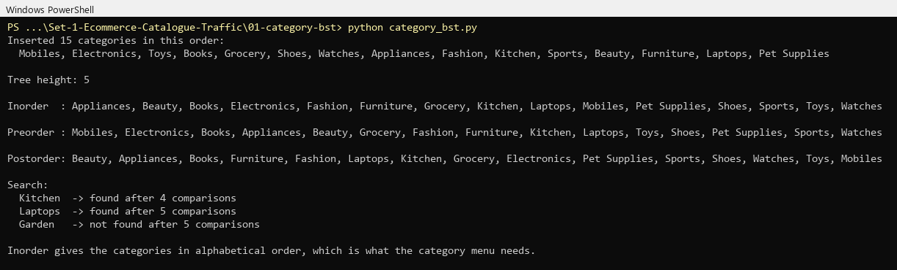
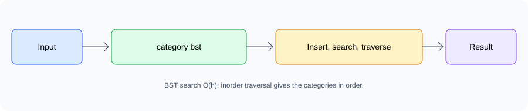

# Question 1 – Category bst

**Question:** Build a Binary Search Tree of product categories (insert, search) and print the inorder, preorder and postorder traversals for 15 sample categories.

## Files

- [category_bst.py](category_bst.py)
- [output.txt](output.txt) – console output
- [flowchart.svg](flowchart.svg) – steps of the solution

## How to run

```bash
python category_bst.py
```

## Output

**python category_bst.py**



## Approach



**Complexity:** BST search O(h); inorder traversal gives the categories in order.
