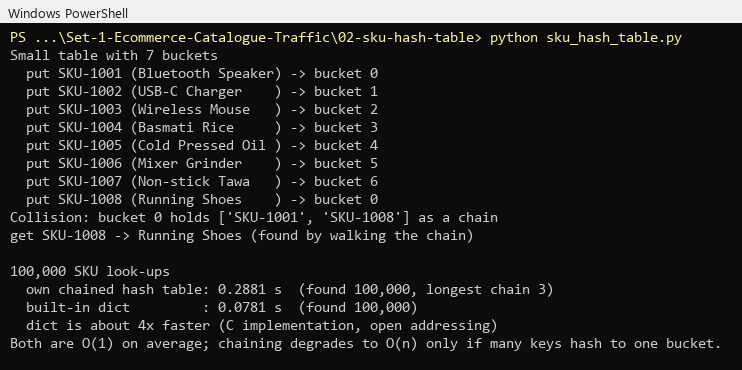
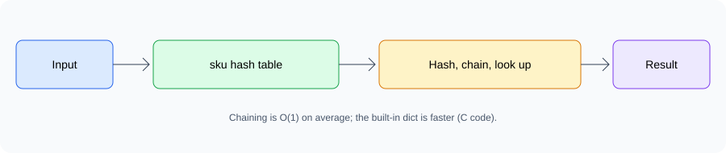

# Question 2 – Sku hash table

**Question:** Implement a small hash table with chaining for SKU look-up, demonstrate one collision, then solve the same problem with the built-in hash map and compare the look-up time for 100,000 SKUs.

## Files

- [sku_hash_table.py](sku_hash_table.py)
- [output.txt](output.txt) – console output
- [flowchart.svg](flowchart.svg) – steps of the solution

## How to run

```bash
python sku_hash_table.py
```

## Output

**python sku_hash_table.py**



## Approach



**Complexity:** Chaining is O(1) on average; the built-in dict is faster (C code).
