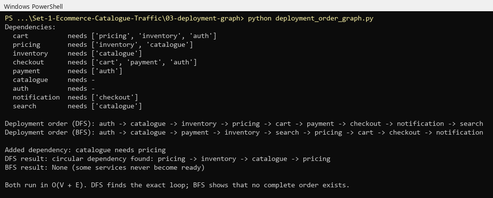
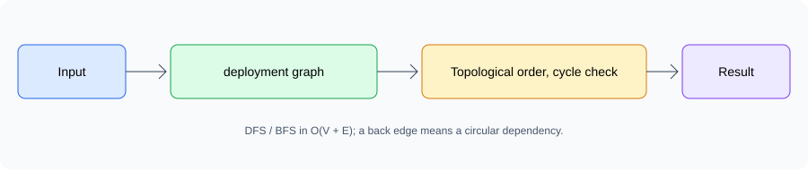

# Question 3 – Deployment graph

**Question:** Model microservice deployment dependencies (cart → pricing → inventory, and so on) as a graph; produce a valid deployment order with BFS/DFS and detect a circular dependency.

## Files

- [deployment_order_graph.py](deployment_order_graph.py)
- [output.txt](output.txt) – console output
- [flowchart.svg](flowchart.svg) – steps of the solution

## How to run

```bash
python deployment_order_graph.py
```

## Output

**python deployment_order_graph.py**



## Approach



**Complexity:** DFS / BFS in O(V + E); a back edge means a circular dependency.
