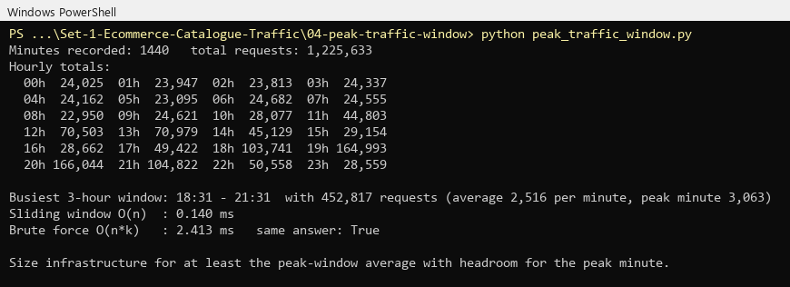
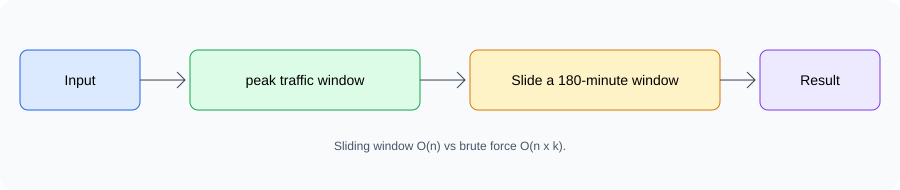

# Question 4 – Peak traffic window

**Question:** Given requests-per-minute for 24 hours, find the busiest continuous 3-hour window using a sliding window.

## Files

- [peak_traffic_window.py](peak_traffic_window.py)
- [output.txt](output.txt) – console output
- [flowchart.svg](flowchart.svg) – steps of the solution

## How to run

```bash
python peak_traffic_window.py
```

## Output

**python peak_traffic_window.py**



## Approach



**Complexity:** Sliding window O(n) vs brute force O(n x k).
