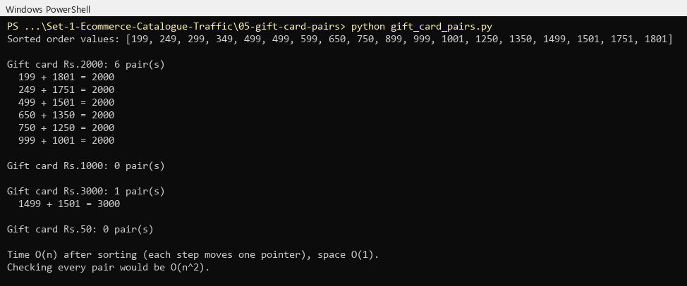
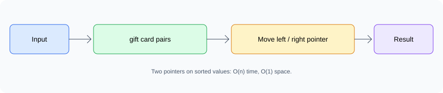

# Question 5 – Gift card pairs

**Question:** Given a sorted list of order values, use two pointers to find all pairs that add up to a gift-card value.

## Files

- [gift_card_pairs.py](gift_card_pairs.py)
- [output.txt](output.txt) – console output
- [flowchart.svg](flowchart.svg) – steps of the solution

## How to run

```bash
python gift_card_pairs.py
```

## Output

**python gift_card_pairs.py**



## Approach



**Complexity:** Two pointers on sorted values: O(n) time, O(1) space.
