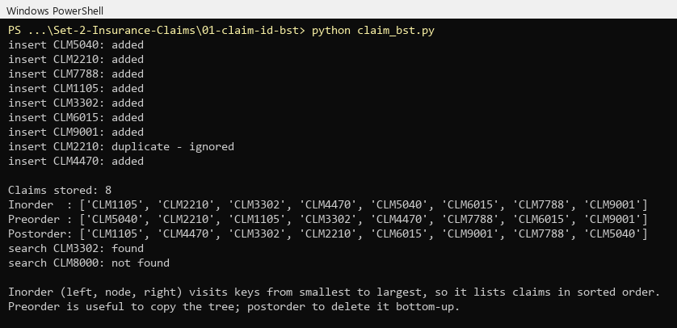
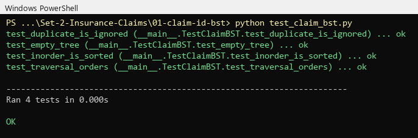

# Question 1 – Claim id bst

**Question:** Create a BST of claim IDs with insert and search; show the three traversals and explain which traversal gives claims in sorted order.

## Files

- [claim_bst.py](claim_bst.py)
- [test_claim_bst.py](test_claim_bst.py)
- [output.txt](output.txt) – console output
- [flowchart.svg](flowchart.svg) – steps of the solution

## How to run

```bash
python claim_bst.py
python test_claim_bst.py
```

## Output

**python claim_bst.py**



**python test_claim_bst.py**



## Approach


**Complexity:** Inorder gives claims in sorted order; tests cover empty tree and duplicates.
