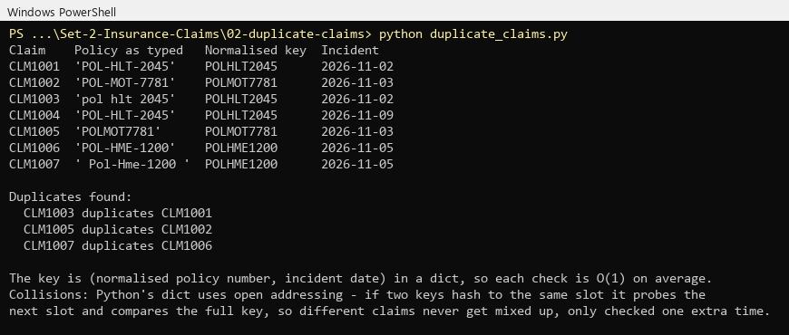
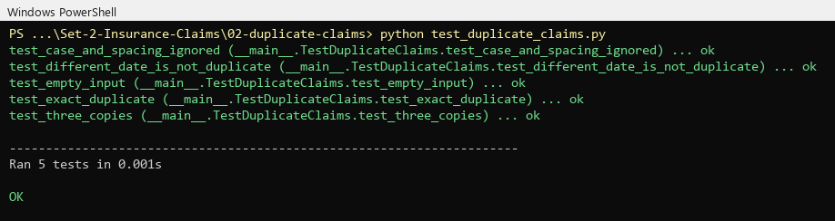
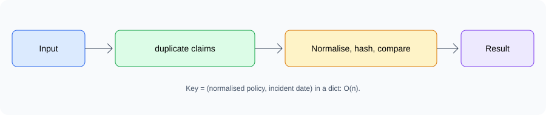

# Question 2 – Duplicate claims

**Question:** Use hashing to detect duplicate or near-duplicate claims (same policy number and incident date, differing only in letter case or spacing); explain how collisions are handled.

## Files

- [duplicate_claims.py](duplicate_claims.py)
- [test_duplicate_claims.py](test_duplicate_claims.py)
- [output.txt](output.txt) – console output
- [flowchart.svg](flowchart.svg) – steps of the solution

## How to run

```bash
python duplicate_claims.py
python test_duplicate_claims.py
```

## Output

**python duplicate_claims.py**



**python test_duplicate_claims.py**



## Approach



**Complexity:** Key = (normalised policy, incident date) in a dict: O(n).
