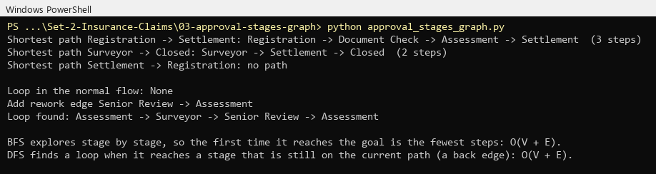
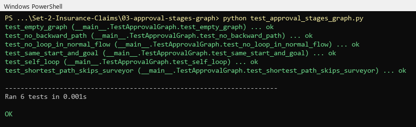
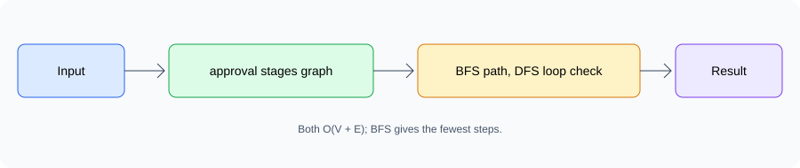

# Question 3 – Approval stages graph

**Question:** Model claim approval stages (registration, assessment, surveyor, settlement) as a directed graph and find the shortest path between two stages using BFS; detect loops using DFS.

## Files

- [approval_stages_graph.py](approval_stages_graph.py)
- [test_approval_stages_graph.py](test_approval_stages_graph.py)
- [output.txt](output.txt) – console output
- [flowchart.svg](flowchart.svg) – steps of the solution

## How to run

```bash
python approval_stages_graph.py
python test_approval_stages_graph.py
```

## Output

**python approval_stages_graph.py**



**python test_approval_stages_graph.py**



## Approach



**Complexity:** Both O(V + E); BFS gives the fewest steps.
