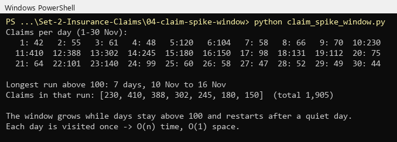
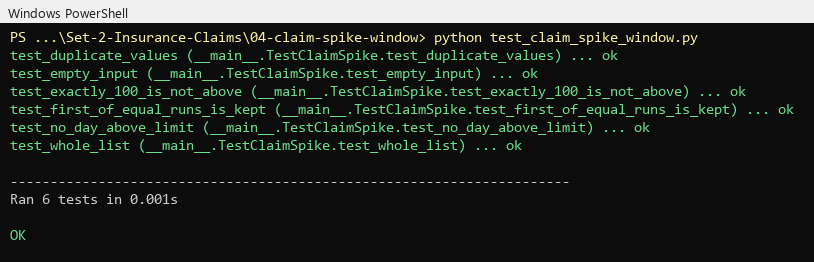

# Question 4 – Claim spike window

**Question:** Find the longest run of consecutive days on which claims exceeded 100 using a sliding window.

## Files

- [claim_spike_window.py](claim_spike_window.py)
- [test_claim_spike_window.py](test_claim_spike_window.py)
- [output.txt](output.txt) – console output
- [flowchart.svg](flowchart.svg) – steps of the solution

## How to run

```bash
python claim_spike_window.py
python test_claim_spike_window.py
```

## Output

**python claim_spike_window.py**



**python test_claim_spike_window.py**



## Approach


**Complexity:** Longest run of days above 100: O(n) time, O(1) space.
