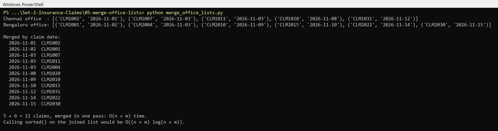
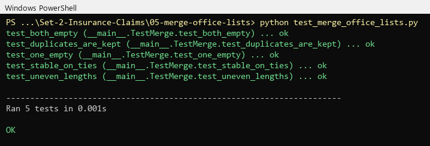

# Question 5 – Merge office lists

**Question:** Using two pointers, merge two sorted claim lists (from two regional offices) into a single sorted list without extra sorting.

## Files

- [merge_office_lists.py](merge_office_lists.py)
- [test_merge_office_lists.py](test_merge_office_lists.py)
- [output.txt](output.txt) – console output
- [flowchart.svg](flowchart.svg) – steps of the solution

## How to run

```bash
python merge_office_lists.py
python test_merge_office_lists.py
```

## Output

**python merge_office_lists.py**



**python test_merge_office_lists.py**



## Approach


**Complexity:** Two-pointer merge O(n + m), stable on ties.
