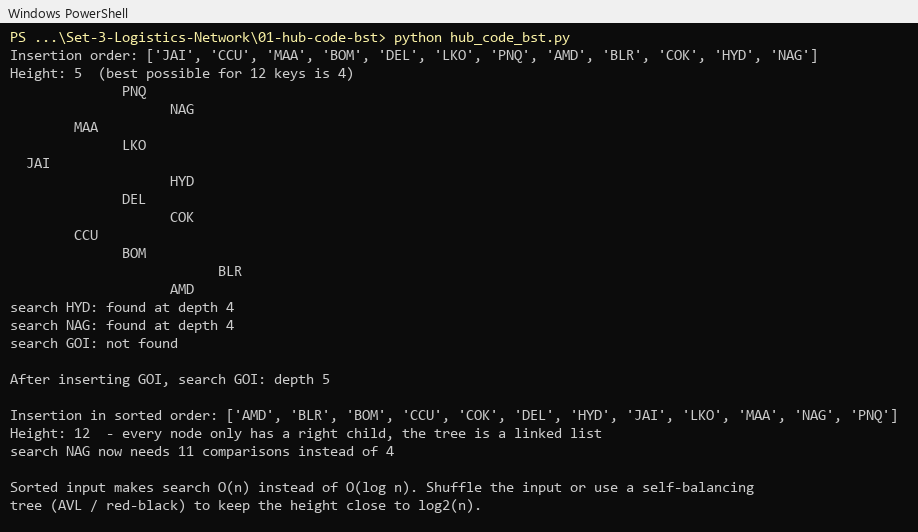
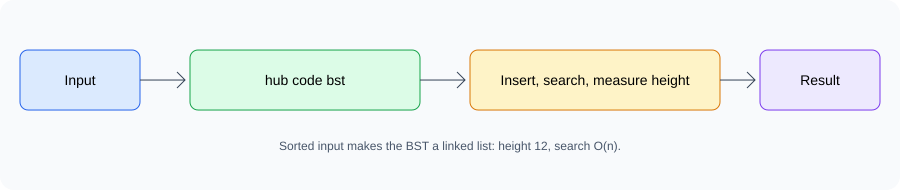

# Question 1 – Hub code bst

**Question:** Store hub codes in a BST and implement search and insert; identify the height of the tree for a given insertion order and explain the effect of sorted input.

## Files

- [hub_code_bst.py](hub_code_bst.py)
- [output.txt](output.txt) – console output
- [flowchart.svg](flowchart.svg) – steps of the solution

## How to run

```bash
python hub_code_bst.py
```

## Output

**python hub_code_bst.py**



## Approach



**Complexity:** Sorted input makes the BST a linked list: height 12, search O(n).
