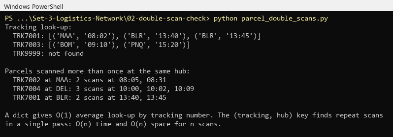
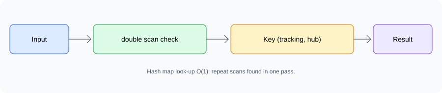

# Question 2 – Double scan check

**Question:** Build a lookup of parcel tracking numbers using a hash map; implement a check that reports parcels scanned twice at the same hub.

## Files

- [parcel_double_scans.py](parcel_double_scans.py)
- [output.txt](output.txt) – console output
- [flowchart.svg](flowchart.svg) – steps of the solution

## How to run

```bash
python parcel_double_scans.py
```

## Output

**python parcel_double_scans.py**



## Approach



**Complexity:** Hash map look-up O(1); repeat scans found in one pass.
