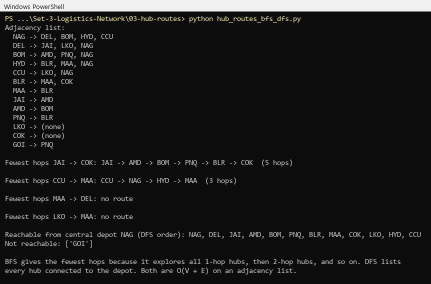
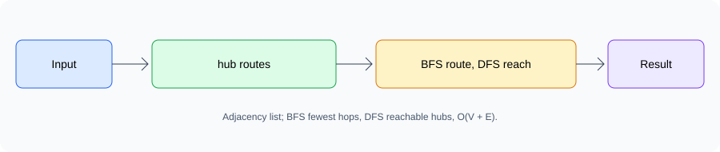

# Question 3 – Hub routes

**Question:** Represent 10 hubs and their direct routes as an adjacency list; find the route with the fewest hops between two hubs (BFS) and list every hub reachable from the central depot (DFS).

## Files

- [hub_routes_bfs_dfs.py](hub_routes_bfs_dfs.py)
- [output.txt](output.txt) – console output
- [flowchart.svg](flowchart.svg) – steps of the solution

## How to run

```bash
python hub_routes_bfs_dfs.py
```

## Output

**python hub_routes_bfs_dfs.py**



## Approach



**Complexity:** Adjacency list; BFS fewest hops, DFS reachable hubs, O(V + E).
