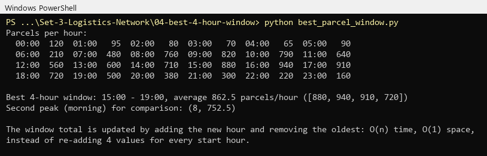
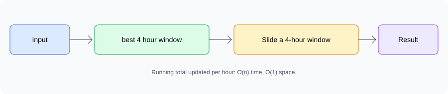

# Question 4 – Best 4 hour window

**Question:** Given hourly parcel counts, find the 4-hour window with the highest average using a sliding window.

## Files

- [best_parcel_window.py](best_parcel_window.py)
- [output.txt](output.txt) – console output
- [flowchart.svg](flowchart.svg) – steps of the solution

## How to run

```bash
python best_parcel_window.py
```

## Output

**python best_parcel_window.py**



## Approach



**Complexity:** Running total updated per hour: O(n) time, O(1) space.
