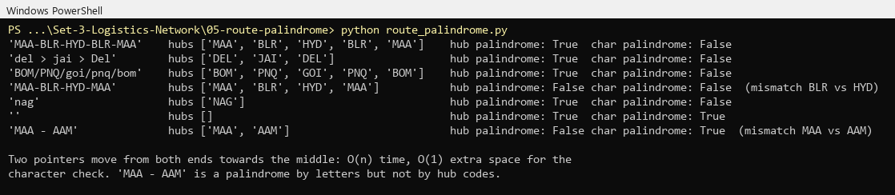
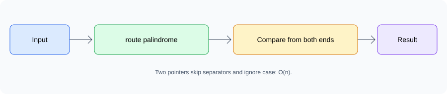

# Question 5 – Route palindrome

**Question:** Use two pointers to check whether a delivery route description is a palindrome of hub codes, ignoring case and separators.

## Files

- [route_palindrome.py](route_palindrome.py)
- [output.txt](output.txt) – console output
- [flowchart.svg](flowchart.svg) – steps of the solution

## How to run

```bash
python route_palindrome.py
```

## Output

**python route_palindrome.py**



## Approach



**Complexity:** Two pointers skip separators and ignore case: O(n).
